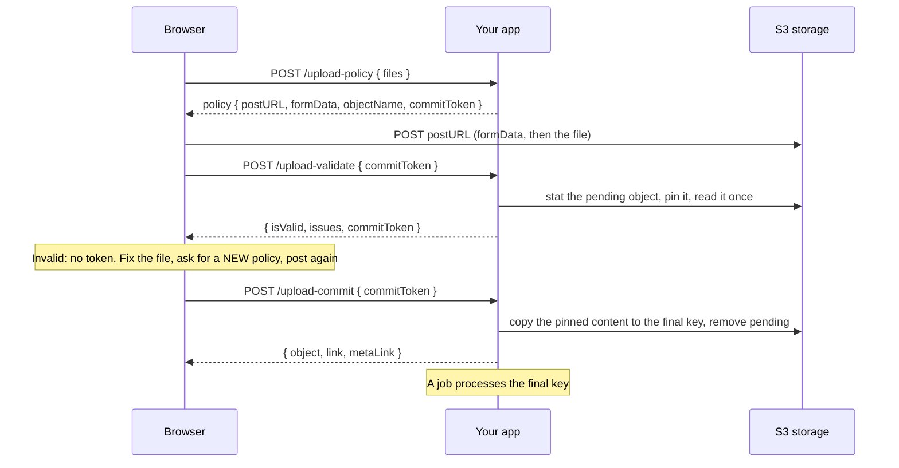

# Direct Upload

With `directUpload` the bytes never touch your process. Your app signs a permission, the browser posts the file to S3, your code checks it, and a commit moves it to its final key. With a [`validation`](#validation) on, commit with the token that `upload-validate` returned. Who commits, and with which token, is [your choice](#who-commits-and-with-which-token).

```ts
import { Authentication } from '@venizia/ignis';
import { applicationEnvironment } from '@venizia/ignis-helpers';
import type { BunS3Helper } from '@venizia/ignis-helpers/bun-s3';
import type { TStaticAssetComponentOptions } from '@venizia/ignis/static-asset';

export const buildUploads = (opts: { storage: BunS3Helper }): TStaticAssetComponentOptions => ({
  uploads: {
    basePath: '/uploads',
    bucket: 'uploads',
    keyPrefix: 'files/',
    helper: opts.storage,
    auth: { authenticate: { strategies: [Authentication.STRATEGY_JWT] } },
    serverUpload: { use: false },
    metaLink: { use: false },
    directUpload: {
      use: true,
      secretKey: applicationEnvironment.get<string>('APP_ENV_UPLOAD_SECRET'),
      maxBytes: 100 * 1024 * 1024,
      validation: { use: false },
      resolvers: {
        owner: ({ context }) => String(context.get(Authentication.CURRENT_USER).userId),
      },
    },
  },
});
```

`directUpload` has four requirements, and the types enforce each:

| Needs | Why |
|---|---|
| a `BunS3Helper` | A policy is a POST policy, and only S3 can sign one. A `DiskHelper` is refused. |
| a `bucket` | A policy names one bucket, and a bucket in the URL is a bucket the caller chooses. Every entry has one. |
| a `keyPrefix` | It keeps the pending files outside everything the routes serve. See [The pending prefix](./security#the-pending-prefix). |
| `resolvers.owner` | A token is signed for one owner, and only that owner commits it. See [Resolvers](#resolvers). |

Three routes appear: `upload-policy`, `upload-validate` (only with a [`validation`](#validation)) and `upload-commit`. Each has its own entry in `routes`, so you can move, guard or drop it. Dropping `upload-commit` leaves the commit to your own code: see [Who commits, and with which token](#who-commits-and-with-which-token).

## The flow



1. **Policy.** The browser names its files. Your app answers one policy per file: where to post, the form fields to send, and a `commitToken`. The pending key is `pendingPrefix` + `keyPrefix` + a generated folder + the file name, for example `pending/files/6f1c.../report.xlsx`.
2. **Post to storage.** The browser sends the form to S3. Your app sees no byte.
3. **Validate.** Your code reads the pending file once and returns its problems. A valid file also gets a new `commitToken`, bound to the exact content that was read. See [Validation](#validation) and [The pin](#the-pin).
4. **Fix and re-upload.** A bad file is fixed on the user's side and uploaded again with a **new policy**. The abandoned pending object is left for the [lifecycle rule](./security#clean-up-the-pending-prefix).
5. **Commit.** With the token validate returned (the policy's token when `validation` is off), the file is copied to its final key (the same key without the `pending/` part: `files/6f1c.../report.xlsx`) and its MetaLink row is written. Commit does not run your check again: with a validated token, the copy happens only if the content still matches the pin. The commit is the "accepted" mark: an object at a final key was accepted, so no tags are needed.
6. **Job.** Your code picks the committed object up from the commit result.

The commit is not ceremony. Storage tells your backend nothing, so without it there is no MetaLink row and no way to attach the object to an order, a ticket or a user.

## The browser, step by step

```ts
interface IUploadPolicy {
  postURL: string;
  formData: Record<string, string>;
  objectName: string;
  commitToken: string;
  expiresAt: string;
}

export const requestPolicy = async (opts: {
  basePath: string;
  file: File;
  token: string;
}): Promise<IUploadPolicy> => {
  const response = await fetch(`${opts.basePath}/upload-policy`, {
    method: 'POST',
    headers: { 'content-type': 'application/json', authorization: `Bearer ${opts.token}` },
    body: JSON.stringify({
      files: [{ fileName: opts.file.name, contentType: opts.file.type, size: opts.file.size }],
    }),
  });
  const policies = (await response.json()) as IUploadPolicy[];

  return policies[0];
};

export const postToStorage = async (opts: { policy: IUploadPolicy; file: File }): Promise<void> => {
  const form = new FormData();
  const formFields = Object.entries(opts.policy.formData);

  for (const [fieldName, fieldValue] of formFields) {
    form.append(fieldName, fieldValue);
  }

  // Last, always: storage reads the form in order and ignores whatever follows the file.
  form.append('file', opts.file);

  const response = await fetch(opts.policy.postURL, { method: 'POST', body: form });

  if (!response.ok) {
    throw new Error(`Storage refused the upload: ${response.status}`);
  }
};
```

> [!NOTE]
> `fileName` must be one valid key segment: no `/`, `\\` or `..`, no leading dot, no control characters, at most 255 bytes. Anything else answers `400` `core.static_asset.object_name_invalid` and nothing is signed. Send the name as it is; the server never sanitizes it.

> [!WARNING]
> `file` must be the last field. The `key` is already in `formData`, signed: do not append your own, and do not change it. A policy is good for exactly that one object.

Then validate, and commit with the token validate returns:

```ts
interface ICellIssue {
  sheet: string;
  row: number;
  column: string;
  code: string;
  message: string;
}

export const validateUpload = async (opts: {
  basePath: string;
  commitToken: string;
  token: string;
}): Promise<{ isValid: boolean; issues: ICellIssue[]; commitToken?: string }> => {
  const response = await fetch(`${opts.basePath}/upload-validate`, {
    method: 'POST',
    headers: { 'content-type': 'application/json', authorization: `Bearer ${opts.token}` },
    body: JSON.stringify({ commitToken: opts.commitToken }),
  });

  return (await response.json()) as {
    isValid: boolean;
    issues: ICellIssue[];
    commitToken?: string;
  };
};

export const commitUpload = async (opts: {
  basePath: string;
  commitToken: string;
  token: string;
  productId: string;
}): Promise<Response> => {
  return fetch(`${opts.basePath}/upload-commit`, {
    method: 'POST',
    headers: { 'content-type': 'application/json', authorization: `Bearer ${opts.token}` },
    body: JSON.stringify({
      commitToken: opts.commitToken,
      principalType: 'Product',
      principalId: opts.productId,
      sequence: 0,
    }),
  });
};
```

Pass `commitToken` from the validate answer to `commitUpload`, not the one the policy issued. With `validation` off there is no validate call, and commit takes the policy's token. The four combinations are in [Who commits, and with which token](#who-commits-and-with-which-token).

The commit body takes the same labels as a [server upload](./server-upload#the-request), except `folderPath`: the key, and so the folder, was fixed when the policy was issued. Labels are read from the body only; a label in the URL is ignored. A `sequence` that is not an integer fails the body's validation with the standard validation error.

A runnable page that performs the steps and prints each request is at [`/direct-upload-demo.html`](/direct-upload-demo.html). Open your browser's Network tab while it runs and watch the post leave without touching the backend.

## Validation

Check the file before it is accepted. You write the check and the shape of one issue; the component adds the route, the authorization and the refusal.

```ts
import { z } from '@hono/zod-openapi';
import { StaticAssetValidation } from '@venizia/ignis/static-asset';

const CellIssueSchema = z.object({
  sheet: z.string(),
  row: z.number().int(),
  column: z.string(),
  code: z.string(),
  message: z.string(),
});

export const workbookValidation = (opts: {
  checkWorkbook: (opts: {
    key: string;
    size: number;
    stream: ReadableStream<Uint8Array>;
    owner?: string;
  }) => Promise<z.infer<typeof CellIssueSchema>[]>;
}) =>
  StaticAssetValidation.define({
    issueSchema: CellIssueSchema,
    handler: async ({ file, owner }) => {
      const stream = await file.stream();
      const issues = await opts.checkWorkbook({ key: file.key, size: file.size, stream, owner });

      return { isValid: issues.length === 0, issues };
    },
  });
```

`define` returns the check already switched on (`{ use: true, issueSchema, handler }`). Pass it as `directUpload.validation`. Leave `validation: { use: false }` when there is nothing to check.

- `issueSchema` is the shape of **one** issue. It types the handler (an issue of another shape fails type-checking) and documents the route's response.
- The handler receives `{ file, owner }`. `file` is a `StaticAssetPinnedFile` and `owner` is the one the token was issued to. It answers `{ isValid, issues }`. It no longer receives the helper, the bucket or the object.
- Switching `validation` on registers `POST {base}/upload-validate`. It takes `{ commitToken }` and answers `{ isValid, issues, commitToken? }`, with the issues in your shape. It calls `authorize` first, like the other routes.
- **Commit does not run the handler.** With `validation` on, commit takes only the token validate returned. The policy's token is refused with `422` `core.static_asset.upload_not_validated`, so an unvalidated file can never be committed: not by skipping the validate call, not by a forged client.

### `StaticAssetPinnedFile`

Every read goes through `file`, and every read is for the content that was pinned.

| Member | Type | Meaning |
|---|---|---|
| `key` | `string` | The pending object's key. |
| `size` | `number` | Its size in bytes. |
| `stream({ range? })` | `Promise<ReadableStream<Uint8Array>>` | The content, or a byte window of it. `range` includes `end`, like the HTTP header. |

A `stream` call that finds other content, or no object, fails with `409` `core.static_asset.upload_changed`. Call it as often as you need: each read is checked.

### The pin

`validate` stats the pending object and pins what it finds: the exact version id when the bucket has real versions, else the ETag. The pin is signed into the new `commitToken`. No extra object is created.

| Where the pin is checked | When the content differs, or the object is gone |
|---|---|
| Every `file.stream()` read | `409` `core.static_asset.upload_changed` |
| The copy `commit` makes | `409` `core.static_asset.upload_changed`, and nothing is copied or removed |

The pin is chosen per object, from the stat. A version id of `null`, an empty one or none means the object has no version, so the ETag pins. A storage that reports no ETag cannot be pinned, and `validate` fails.

The pin is what makes "validated" mean something: a file overwritten after validation cannot ride the validated token. See [what the pin protects](./security#the-pin-binds-the-token-to-the-content).

### The `upload-validate` contract

One token per call, answered exactly like this:

| Case | Answer | Your handler runs? |
|---|---|---|
| A valid token, a good file | `200` `{ isValid: true, issues: [], commitToken }` | yes |
| A valid token, a bad file | `200` `{ isValid: false, issues }` | yes |
| A malformed body | `422` | no |
| Unauthenticated, per the entry's `auth` | `401` | no |
| `directUpload.authorize` returns `false` | `403` `upload_not_authorized` | no |
| A forged token, or a different owner | `400` `invalid_commit_token` | no |
| `expires.commit` has passed | `400` `expired_commit_token` | no |
| A key outside the `keyPrefix`, or no object there | `404` `object_not_found` | no |
| The object changed during the read | `409` `upload_changed` | yes |

- **The token is present only when the file is valid.** It has the same expiry as the token you sent. An invalid file answers no token.
- **A file with problems is still a `200`.** `isValid: false` and the issues ride the body; the status tells you the call worked, not that the file is good. Each issue has the shape of your `issueSchema`, and OpenAPI shows it. The body names no file and no key: the client knows which token it sent.
- **With `validation` off the route does not exist.** The request answers `404`.
- **Validate does not consume the token.** Call it as often as you like until `expires.commit`. A token of either stage can be validated again, and it pins whatever is there at that moment. A re-upload is a new object, so it needs a new policy and a new token.
- **Commit with the policy's token answers `422` `upload_not_validated`.** Commit with the token validate returned.
- **Many files, many tokens.** `upload-policy` takes several files and returns one policy and one token per file. Validate and commit each token on its own; there is no batch call.

Work after a commit is yours: do it in the code that calls `commit`, or in `metaLink.createMetaLink`. There is no hook between the check and the copy.

## Who commits, and with which token

Two switches decide who commits and which token commit takes. Both have a default, so most apps never touch them.

| Switch | On | Off |
|---|---|---|
| `directUpload.validation` | `{ use: true, ... }`: the `upload-validate` route exists, and `commit` accepts only a `validated` token, the one validate returned. | `{ use: false }`: no validate route. `commit` takes the `issued` token from `upload-policy`. |
| `routes.uploadCommit` | The default. The client calls `POST {basePath}/upload-commit`. | `{ use: false }`: the route does not exist. Your own code commits through `StaticAssetUploadCommitService.commit({ token, owner?, labels? })`. |

Inject the service with `@inject({ key: StaticAssetBindingKeys.commitService({ name }) })`. `name` is the entry's key in the options object, not the controller name.

| Validation | Commit route | Direct-upload routes | `commit` accepts | Who calls `commit` |
|---|---|---|---|---|
| off | on | `upload-policy`, `upload-commit` | the `issued` token | the client |
| on | on | `upload-policy`, `upload-validate`, `upload-commit` | the `validated` token | the client |
| on | off | `upload-policy`, `upload-validate` | the `validated` token | your code, through the service |
| off | off | `upload-policy` | the `issued` token | your code, through the service |

Step 1 is the same in all four cases. The client asks for a policy, then posts the file to `postURL`. The policy answers one entry per file. The examples below use an entry with `basePath: '/assets'`.

```http
POST /assets/upload-policy
{ "files": [{ "fileName": "orders.xlsx", "size": 48213 }] }

200
[
  {
    "postURL": "https://s3.example.com/uploads",
    "formData": { "key": "pending/files/7f2c.../orders.xlsx", "...": "the other signed form fields" },
    "expiresAt": "2026-11-11T11:03:48.399Z",
    "objectName": "pending/files/7f2c.../orders.xlsx",
    "commitToken": "eyJ..."
  }
]
```

This `commitToken` is the `issued` token. It has no pin.

### Validation off, commit route on

The default. Three calls: policy, post to storage, `upload-commit` with the policy's token.

```http
POST /assets/upload-commit
{ "commitToken": "eyJ..." }

200
{
  "bucket": { "name": "uploads" },
  "object": { "key": "files/7f2c.../orders.xlsx" },
  "link": "/assets/objects/files%2F7f2c...%2Forders.xlsx",
  "metaLink": {
    "data": {
      "id": "1",
      "bucketName": "uploads",
      "objectName": "files/7f2c.../orders.xlsx",
      "link": "/assets/objects/files%2F7f2c...%2Forders.xlsx",
      "mimetype": "application/vnd.openxmlformats-officedocument.spreadsheetml.sheet",
      "size": 48213,
      "etag": "\"9b2cf535f27731c974343645a3985328\"",
      "metadata": {
        "mimetype": "application/vnd.openxmlformats-officedocument.spreadsheetml.sheet",
        "content-type": "application/vnd.openxmlformats-officedocument.spreadsheetml.sheet"
      },
      "isSynced": true,
      "storageType": "bun-s3"
    }
  }
}
```

`POST /assets/upload-validate` answers `404 Not Found`: with `validation` off the route does not exist. The copy is unconditional, because the `issued` token carries no pin.

```ts
export const commitWithPolicyToken = async (opts: {
  basePath: string;
  policyCommitToken: string;
  token: string;
}): Promise<Response> => {
  return fetch(`${opts.basePath}/upload-commit`, {
    method: 'POST',
    headers: { 'content-type': 'application/json', authorization: `Bearer ${opts.token}` },
    body: JSON.stringify({ commitToken: opts.policyCommitToken }),
  });
};
```

### Validation on, commit route on

Four calls: policy, post to storage, `upload-validate`, `upload-commit` with the token validate returned.

```http
POST /assets/upload-validate
{ "commitToken": "eyJ..." }

200
{ "isValid": true, "issues": [], "commitToken": "eyJ..." }
```

This second `commitToken` differs from the policy's. It is the `validated` token and carries the pin. `upload-commit` answers `200` with the body shown above, and copies the pinned content to the final key.

Commit with the policy's token instead, and nothing is copied:

```http
POST /assets/upload-commit
{ "commitToken": "eyJ..." }

422
{
  "message": "The upload has not been validated",
  "statusCode": 422,
  "normalized": {
    "text": "The upload has not been validated",
    "code": "core.static_asset.upload_not_validated",
    "args": {}
  },
  "extra": { "category": "validation" },
  "details": { "url": "http://localhost/assets/upload-commit", "path": "/assets/upload-commit" }
}
```

```ts
interface IValidateAnswer {
  isValid: boolean;
  issues: unknown[];
  commitToken?: string;
}

export const validateThenCommit = async (opts: {
  basePath: string;
  policyCommitToken: string;
  token: string;
}): Promise<Response | undefined> => {
  const headers = { 'content-type': 'application/json', authorization: `Bearer ${opts.token}` };

  const validated = await fetch(`${opts.basePath}/upload-validate`, {
    method: 'POST',
    headers,
    body: JSON.stringify({ commitToken: opts.policyCommitToken }),
  });
  const answer = (await validated.json()) as IValidateAnswer;

  if (!answer.isValid || answer.commitToken === undefined) {
    return undefined;
  }

  return fetch(`${opts.basePath}/upload-commit`, {
    method: 'POST',
    headers,
    body: JSON.stringify({ commitToken: answer.commitToken }),
  });
};
```

### Validation on, commit route off

The browser stops after validate. Your server commits, so a review or a payment can sit between the check and the commit. Four steps: policy, post to storage, `upload-validate`, then your own endpoint.

`POST /assets/upload-validate` answers exactly as above, `{ isValid: true, issues: [], commitToken }`. `POST /assets/upload-commit` answers `404 Not Found`. The client sends the returned token to your endpoint, and your endpoint calls the service:

```ts
import { BaseService, inject } from '@venizia/ignis';
import { StaticAssetBindingKeys } from '@venizia/ignis/static-asset';
import type { StaticAssetUploadCommitService } from '@venizia/ignis/static-asset';

export class OrderImportCommitService extends BaseService {
  constructor(
    @inject({ key: StaticAssetBindingKeys.commitService({ name: 'orderImport' }) })
    private assetCommit: StaticAssetUploadCommitService,
  ) {
    super({ scope: OrderImportCommitService.name });
  }

  /** `validatedToken` is the `commitToken` that `upload-validate` returned to the client. */
  async accept(opts: { validatedToken: string; userId: string; orderId: string }) {
    return this.assetCommit.commit({
      token: opts.validatedToken,
      owner: opts.userId,
      labels: { principalType: 'Order', principalId: opts.orderId },
    });
  }
}
```

The service with the policy's token throws the same `core.static_asset.upload_not_validated` (`422`), and nothing is copied.

### Validation off, commit route off

Your own request carries the policy's token together with the application's record, and the service commits while it saves. There is no validate call and no commit route: both answer `404 Not Found`.

```ts
export const saveOrderImport = async (opts: {
  endpoint: string;
  policyCommitToken: string;
  token: string;
  orderId: string;
}): Promise<Response> => {
  return fetch(opts.endpoint, {
    method: 'POST',
    headers: { 'content-type': 'application/json', authorization: `Bearer ${opts.token}` },
    body: JSON.stringify({ commitToken: opts.policyCommitToken, orderId: opts.orderId }),
  });
};
```

On the server, call `commit` with that token as in the [service example](#use-from-a-service), which commits while it saves the record.

### Validation on, validate route off

`routes.uploadValidate: { use: false }` with a `validation` on leaves no HTTP way to get a `validated` token, and commit then accepts nothing else. An application that does this validates and commits through the service itself: `validate({ token, owner? })` answers the token, and `commit` takes it.

```ts
import { BaseService, inject } from '@venizia/ignis';
import { StaticAssetBindingKeys } from '@venizia/ignis/static-asset';
import type { StaticAssetUploadCommitService } from '@venizia/ignis/static-asset';

export class OrderImportCheckService extends BaseService {
  constructor(
    @inject({ key: StaticAssetBindingKeys.commitService({ name: 'orderImport' }) })
    private assetCommit: StaticAssetUploadCommitService,
  ) {
    super({ scope: OrderImportCheckService.name });
  }

  /** Answers the issues when the file is not valid, and nothing when it was committed. */
  async checkAndCommit(opts: { policyCommitToken: string; userId: string }) {
    const result = await this.assetCommit.validate({
      token: opts.policyCommitToken,
      owner: opts.userId,
    });

    if (!result.isValid || result.commitToken === undefined) {
      return result.issues;
    }

    await this.assetCommit.commit({ token: result.commitToken, owner: opts.userId });

    return [];
  }
}
```

### The pending object is gone

A `validated` token pins the content. If the pending object is deleted or overwritten after validate, commit answers `409` `core.static_asset.upload_changed`, and nothing is copied. An `issued` token has no pin, so a missing pending object is the storage's own `404` `core.storage.object_not_found`.

### Nobody commits

A file that is posted and never committed stays under `pendingPrefix`. It has no MetaLink row, and nothing exists at the final key, even after a successful `upload-validate`: validate pins the file and answers a token, and moves nothing. The [lifecycle rule](./security#clean-up-the-pending-prefix) removes the pending object.

## Use from a service

The routes are thin wrappers over two services. The component binds one of each per entry that switches `directUpload` on, so your code can issue a policy, check an upload or commit it without an HTTP call to its own server.

| Service | Key | Methods |
|---|---|---|
| `StaticAssetUploadPolicyService` | `StaticAssetBindingKeys.policyService({ name })` | `issuePolicies({ files, owner })`: one signed policy per file, each good for one key. `files[].metadata` is what the token signs for that file. |
| `StaticAssetUploadCommitService` | `StaticAssetBindingKeys.commitService({ name })` | `verify({ token, owner })`: the checks a commit starts with, no storage call, answers the pending `{ bucket, object, owner, metadata }`. |
| | | `validate({ token, owner })`: `verify`, pin the content, run your `validation` once. A valid file answers `{ isValid: true, issues: [], commitToken }`. With `validation` off it still pins and answers a `commitToken`. |
| | | `commit({ token, owner, labels?, destination? })`: `verify`, copy the pinned content to the final key, remove the pending object, write the MetaLink row. Never runs your `validation`. With `validation` on it needs the validated token. Answers `{ bucket, object, owner, metadata, link, metaLink? }`. |

`name` is the entry's key in the options object (`orderImport`), not the controller name. The HTTP field is `commitToken`; only the service parameter is `token`. Call `validate`, then pass the `commitToken` it answers to `commit`.

Commit while you save your own record, and clean up when the save fails. `'helpers.AssetStorage'` is a placeholder for the key your own application bound the entry's helper under, not one IGNIS provides.

```ts
import { BaseService, inject } from '@venizia/ignis';
import type { IStorageHelper } from '@venizia/ignis-helpers';
import { StaticAssetBindingKeys } from '@venizia/ignis/static-asset';
import type { StaticAssetUploadCommitService } from '@venizia/ignis/static-asset';

export abstract class OrderImportService extends BaseService {
  constructor(
    @inject({ key: StaticAssetBindingKeys.commitService({ name: 'orderImport' }) })
    private assetCommit: StaticAssetUploadCommitService,
    // Your own binding of the helper the entry was configured with.
    @inject({ key: 'helpers.AssetStorage' }) private storage: IStorageHelper,
  ) {
    super({ scope: OrderImportService.name });
  }

  /** Your own write: it fails the way a database write fails. */
  protected abstract saveImport(opts: { link: string; userId: string }): Promise<void>;

  async accept(opts: { commitToken: string; userId: string }): Promise<void> {
    const committed = await this.assetCommit.commit({
      token: opts.commitToken,
      owner: opts.userId,
      labels: { principalType: 'OrderImport', principalId: opts.userId },
    });

    try {
      await this.saveImport({ link: committed.link, userId: opts.userId });
    } catch (error) {
      // The object now sits at its FINAL key, where the pending-prefix lifecycle rule never looks.
      await this.storage
        .removeObject({ bucket: committed.bucket, object: committed.object })
        .catch(() => undefined);

      throw error;
    }
  }
}
```

**Order matters.** `commit` is the point of no return: the object leaves `pending/` for its final key. If saving your record fails afterwards, nothing removes that object for you, so remove it in the failure path as above. The cleanup is best effort: if it fails too, one object stays at the final key until you collect it.

If the MetaLink row cannot be written, `commit` still resolves with `metaLink: { error }`: the object is committed by then, and a throw would send the caller back with a token whose source no longer exists.

> [!WARNING]
> `issuePolicies` does not call `directUpload.authorize`. That check belongs to the routes; code that calls the services decides for itself who may use direct upload. `verify`, `validate` and `commit` still check the token, the owner, the bucket and the pending scope, so a forged, expired, foreign or out-of-scope token is refused before any storage call. `issuePolicies` does not run `resolvers.metadata`: it signs the `metadata` you pass.

### When to turn the commit route off

`upload-commit` lets the browser confirm. When your server decides - after a validation, a review, a payment - drop it and call `commit` from your service. The [four combinations](#who-commits-and-with-which-token) show what each call carries:

```ts
import type { TStaticAssetRoutes } from '@venizia/ignis/static-asset';

export const routes: TStaticAssetRoutes = { uploadCommit: { use: false } };
```

## Resolvers

`directUpload.resolvers` holds the three decisions that belong to your application. Each runs on a different call.

| Resolver | Runs | Decides |
|---|---|---|
| `owner` | every direct-upload route | Who the upload belongs to. **Required.** |
| `metadata` | the policy route, once per file | What the token signs for that file. |
| `commit.destination` | commit | The final key. |

```ts
import { Authentication } from '@venizia/ignis';
import type { TStaticAssetDirectUploadOptions } from '@venizia/ignis/static-asset';

export const directUpload: { use: true } & TStaticAssetDirectUploadOptions = {
  use: true,
  secretKey: 'replace-with-a-real-secret',
  maxBytes: 100 * 1024 * 1024,
  validation: { use: false },
  resolvers: {
    owner: ({ context }) => String(context.get(Authentication.CURRENT_USER).userId),
    metadata: ({ file }) => ({ orderId: file.metadata?.orderId ?? '' }),
    commit: {
      destination: ({ metadata, file }) => ({ key: `files/${metadata.orderId}/${file.fileName}` }),
    },
  },
};
```

### Who owns an upload

`resolvers.owner` runs on the policy route, which signs the answer into the token, and on the commit and validate routes, which refuse a token whose owner differs as an invalid token. The refusal is the same one a forged token gets, so it reveals nothing. When you call the services yourself, pass the same `owner` you would have resolved.

### Metadata signed in the token

`resolvers.metadata` receives `{ context, file }` for each file of the policy request and returns `Record<string, string>`. The token signs exactly that. A client cannot change it, and it comes back on every later call:

- `verify({ token, owner })` answers `{ bucket, object, owner, metadata }`.
- The validation handler receives `{ file, owner, metadata }`.
- `commit` answers `{ ..., owner, metadata }`, and writes `metadata` into the MetaLink row's `metadata` column under the key `app`. A later refresh of the row keeps it.

The client may send a hint: `files[].metadata` in the policy body reaches your resolver as `file.metadata`, and the framework signs **only what the resolver returns**. A client that sends `metadata` while no `resolvers.metadata` is set is refused with `400` `core.static_asset.upload_metadata_invalid`.

> [!WARNING]
> The token is signed, not encrypted. The client can read everything in it. Put no secrets in `metadata`.

Each file's metadata is capped at 1024 bytes of JSON. More is refused with `400` `core.static_asset.upload_metadata_invalid` before anything is signed. Values must be strings.

### Choosing the final key

By default the final key is the pending key without the pending prefix: `<keyPrefix><uuid>/<fileName>`. `resolvers.commit.destination` returns another key in the same bucket. It receives `{ owner, metadata, file: { fileName }, defaultKey }`. A service caller can also pass `commit({ token, owner, destination: { key } })`: a given `destination` wins over the resolver, and both go through the same checks.

The key must pass the same checks as a [server upload](./server-upload) key: a valid object key within `maxFolderDepth`, inside `keyPrefix`. One outside the scope answers `400` `core.static_asset.object_key_out_of_scope`; one that is not a valid key answers `400` `core.static_asset.object_name_invalid`. Nothing is copied.

### A commit is single-use

Commit checks the destination first. An object already there answers `409` `core.static_asset.upload_already_committed`, and nothing is copied or recorded. The body's `extra` names that object, so a client that retries after a lost response still gets its link:

```json
{ "extra": { "object": { "key": "files/3f2c.../a.png" }, "link": "/uploads/objects/files%2F3f2c...%2Fa.png" } }
```

It is answered only after the signature and owner check, so it tells the holder of a valid token nothing new. A POST policy stays valid until it expires, so without this check a client could post again to the pending key and commit again over the first object. A destination that two different tokens both resolve to is refused the same way.

The check is one `HEAD`, and it is not atomic with the copy: two commits of one token racing in the same instant can both pass it. The pending object is removed by the first, so the second then fails on its copy.

## How long things live

| Option | Default | What it bounds |
|---|---|---|
| `expires.upload` | 15 minutes | The window to post the file: the policy's lifetime. |
| `expires.commit` | `expires.upload` | How long the token can validate and commit. The token validate returns keeps the same expiry. |

Keep `expires.upload` short, and set `expires.commit` to however long users need to validate, fix and confirm.

```ts
import { DurationUnits } from '@venizia/ignis-helpers';
import type { TStaticAssetDirectUploadOptions } from '@venizia/ignis/static-asset';

export const directUpload: { use: true } & TStaticAssetDirectUploadOptions = {
  use: true,
  secretKey: 'replace-with-a-real-secret',
  maxBytes: 100 * 1024 * 1024,
  validation: { use: false },
  resolvers: { owner: () => 'user-a' },
  expires: {
    upload: { unit: DurationUnits.MINUTE, value: 10 },
    commit: { unit: DurationUnits.HOUR, value: 6 },
  },
};
```

The pending object must outlive `expires.commit`; see [clean up the pending prefix](./security#clean-up-the-pending-prefix).

## Options

`directUpload` takes these beside `use`.

| Option | Type | Default | Meaning |
|---|---|---|---|
| `secretKey` | `string` | - | **Required.** Signs the commit token. Keep it out of the repository and out of the client. |
| `maxBytes` | `number` | - | **Required.** The ceiling the policy carries as `content-length-range`. Over it answers `413` `core.static_asset.upload_too_large`. |
| `authorize` | `({ context }) => ValueOrPromise<boolean>` | the entry's `auth` | Who may use direct upload. Guards every direct-upload route: `false` answers `403` `core.static_asset.upload_not_authorized` before the body is read or storage is touched. May be left out only when `auth` authenticates or authorizes; with neither, the entry refuses to start. |
| `resolvers` | `{ owner, metadata?, commit?: { destination? } }` | - | **Required**, `owner` included. See [Resolvers](#resolvers). |
| `maxFiles` | `number` | `20` | Most files one policy request may name. More answers `422`. |
| `pendingPrefix` | `string` | `'pending/'` | Where a policy may write. Not empty, ends with `/`, valid key segments, and neither inside `keyPrefix` nor containing it. The final key is never inside it. See [The pending prefix](./security#the-pending-prefix). |
| `expires.upload` | `IDuration` | 15 minutes | The policy's lifetime. |
| `expires.commit` | `IDuration` | `expires.upload` | The token's lifetime. |
| `validation` | `{ use: false }` or `StaticAssetValidation.define(...)` | - | **Required.** Your check of the pending file. On, `commit` takes only the `validated` token. See [Validation](#validation) and [Who commits](#who-commits-and-with-which-token). |

## Why a policy and not a presigned PUT

A signed PUT binds each header to an **exact** value. `content-length: 2048` means exactly 2048 bytes; there is no way to say "at most 2 MB". The client would have to know the byte count before asking, and every retry or re-encode would become an opaque 403.

A POST policy signs a document of conditions instead. `content-length-range` says what equality cannot, and the `key` condition pins the form to one object.

Worth knowing even if you never reach for it: a presigned PUT is also **reusable until it expires** and **overwrites** an existing key. Anyone who intercepts one can replace the object.

## Behind a private endpoint

`host` is inside every SigV4 signature, so the `postURL` your browser receives cannot be rewritten afterwards. Give the helper both hosts:

```ts
import { BunS3Helper } from '@venizia/ignis-helpers/bun-s3';

export const storage = new BunS3Helper({
  accessKey: 'access-key',
  secretKey: 'secret-key',
  endpoint: {
    default: 'http://minio:9000', // what this process talks to
    public: 'https://cdn.example.com', // what the browser is handed
  },
});
```

## When step 2 answers 403

The policy is doing its job. In order of likelihood:

| Cause | Check |
|---|---|
| The bucket refuses cross-origin POST | your bucket's CORS rules - this one costs people an afternoon |
| The file is over `maxBytes` | the `content-length-range` condition |
| The `key` field is not the one the policy signed | you changed it, or posted a second object with one policy |
| The policy expired | `expiresAt`, and `expires.upload` |

## Deliberately not built

Multipart and resumable upload. Malware scanning: scan inside your `validation.handler`, and read [the pin](./security#the-pin-binds-the-token-to-the-content) first. A commit token carrying business fields beyond the owner.

**Files:**

- [`packages/helpers/src/modules/storage/bun-s3/utility.ts`](https://github.com/VENIZIA-AI/ignis/blob/main/packages/helpers/src/modules/storage/bun-s3/utility.ts) - `S3SignatureUtility.buildPostPolicy`
- [`packages/core-server/src/components/static-asset/services/policy.service.ts`](https://github.com/VENIZIA-AI/ignis/blob/main/packages/core-server/src/components/static-asset/services/policy.service.ts) - `StaticAssetUploadPolicyService.issuePolicies`
- [`packages/core-server/src/components/static-asset/services/commitment.service.ts`](https://github.com/VENIZIA-AI/ignis/blob/main/packages/core-server/src/components/static-asset/services/commitment.service.ts) - `StaticAssetUploadCommitService.verify`, `validate`, `commit`
- [`packages/core-server/src/components/static-asset/utilities/commit-token.utility.ts`](https://github.com/VENIZIA-AI/ignis/blob/main/packages/core-server/src/components/static-asset/utilities/commit-token.utility.ts) - `StaticAssetCommitTokenUtility.build`, `StaticAssetCommitTokenUtility.read`
