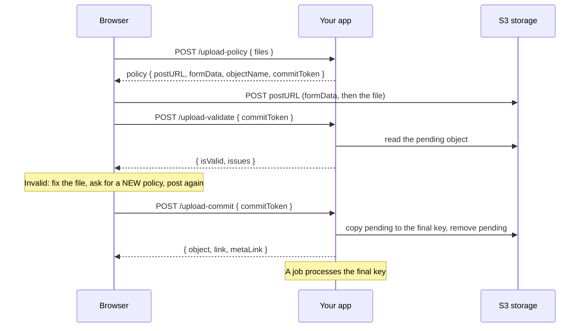

# Direct Upload

With `directUpload` the bytes never touch your process. Your app signs a permission, the browser posts the file to S3, your code checks it, and a commit moves it to its final key.

```ts
import { Authentication } from '@venizia/ignis';
import { applicationEnvironment } from '@venizia/ignis-helpers';
import type { BunS3Helper } from '@venizia/ignis-helpers/bun-s3';
import type { TStaticAssetComponentOptions } from '@venizia/ignis/static-asset';

export const buildUploads = (opts: { storage: BunS3Helper }): TStaticAssetComponentOptions => ({
  uploads: {
    basePath: '/uploads',
    bucket: 'uploads',
    keyPrefix: 'files/',
    helper: opts.storage,
    auth: { authenticate: { strategies: [Authentication.STRATEGY_JWT] } },
    serverUpload: { use: false },
    metaLink: { use: false },
    directUpload: {
      use: true,
      secretKey: applicationEnvironment.get<string>('APP_ENV_UPLOAD_SECRET'),
      maxBytes: 100 * 1024 * 1024,
      validation: { use: false },
    },
  },
});
```

`directUpload` has three requirements, and the types enforce each:

| Needs | Why |
|---|---|
| a `BunS3Helper` | A policy is a POST policy, and only S3 can sign one. A `DiskHelper` is refused. |
| a `bucket` | A policy names one bucket, and a bucket in the URL is a bucket the caller chooses. Every entry has one. |
| a `keyPrefix` | It keeps the pending files outside everything the routes serve. See [The pending prefix](./security#the-pending-prefix). |

Three routes appear: `upload-policy`, `upload-validate` (only with a [`validation`](#validation)) and `upload-commit`. Each has its own entry in `routes`, so you can move, guard or drop it.

## The flow



1. **Policy.** The browser names its files. Your app answers one policy per file: where to post, the form fields to send, and a `commitToken`. The pending key is `pendingPrefix` + `keyPrefix` + a generated folder + the file name, for example `pending/files/6f1c.../report.xlsx`.
2. **Post to storage.** The browser sends the form to S3. Your app sees no byte.
3. **Validate.** Your code reads the pending file and returns its problems. See [Validation](#validation).
4. **Fix and re-upload.** A bad file is fixed on the user's side and uploaded again with a **new policy**. The abandoned pending object is left for the [lifecycle rule](./security#clean-up-the-pending-prefix).
5. **Commit.** A valid file is copied to its final key (the same key without the `pending/` part: `files/6f1c.../report.xlsx`) and its MetaLink row is written. The commit is the "accepted" mark: an object at a final key was accepted, so no tags are needed.
6. **Job.** Your code picks the committed object up from the commit result.

The commit is not ceremony. Storage tells your backend nothing, so without it there is no MetaLink row and no way to attach the object to an order, a ticket or a user.

## The browser, step by step

```ts
interface IUploadPolicy {
  postURL: string;
  formData: Record<string, string>;
  objectName: string;
  commitToken: string;
  expiresAt: string;
}

export const requestPolicy = async (opts: {
  basePath: string;
  file: File;
  token: string;
}): Promise<IUploadPolicy> => {
  const response = await fetch(`${opts.basePath}/upload-policy`, {
    method: 'POST',
    headers: { 'content-type': 'application/json', authorization: `Bearer ${opts.token}` },
    body: JSON.stringify({
      files: [{ fileName: opts.file.name, contentType: opts.file.type, size: opts.file.size }],
    }),
  });
  const policies = (await response.json()) as IUploadPolicy[];

  return policies[0];
};

export const postToStorage = async (opts: { policy: IUploadPolicy; file: File }): Promise<void> => {
  const form = new FormData();
  const formFields = Object.entries(opts.policy.formData);

  for (const [fieldName, fieldValue] of formFields) {
    form.append(fieldName, fieldValue);
  }

  // Last, always: storage reads the form in order and ignores whatever follows the file.
  form.append('file', opts.file);

  const response = await fetch(opts.policy.postURL, { method: 'POST', body: form });

  if (!response.ok) {
    throw new Error(`Storage refused the upload: ${response.status}`);
  }
};
```

> [!WARNING]
> `file` must be the last field. The `key` is already in `formData`, signed: do not append your own, and do not change it. A policy is good for exactly that one object.

Then validate, and commit when the file is valid:

```ts
interface ICellIssue {
  sheet: string;
  row: number;
  column: string;
  code: string;
  message: string;
}

export const validateUpload = async (opts: {
  basePath: string;
  commitToken: string;
  token: string;
}): Promise<{ isValid: boolean; issues: ICellIssue[] }> => {
  const response = await fetch(`${opts.basePath}/upload-validate`, {
    method: 'POST',
    headers: { 'content-type': 'application/json', authorization: `Bearer ${opts.token}` },
    body: JSON.stringify({ commitToken: opts.commitToken }),
  });

  return (await response.json()) as { isValid: boolean; issues: ICellIssue[] };
};

export const commitUpload = async (opts: {
  basePath: string;
  commitToken: string;
  token: string;
  productId: string;
}): Promise<Response> => {
  return fetch(`${opts.basePath}/upload-commit`, {
    method: 'POST',
    headers: { 'content-type': 'application/json', authorization: `Bearer ${opts.token}` },
    body: JSON.stringify({
      commitToken: opts.commitToken,
      principalType: 'Product',
      principalId: opts.productId,
      sequence: 0,
    }),
  });
};
```

The commit body takes the same labels as a [server upload](./server-upload#the-request), except `folderPath`: the key, and so the folder, was fixed when the policy was issued. Labels are read from the body only; a label in the URL is ignored. A `sequence` that is not an integer fails the body's validation with the standard validation error.

A runnable page that performs the steps and prints each request is at [`/direct-upload-demo.html`](/direct-upload-demo.html). Open your browser's Network tab while it runs and watch the post leave without touching the backend.

## Validation

Check the file before it is accepted. You write the check and the shape of one issue; the component adds the route, the authorization and the refusal.

```ts
import { z } from '@hono/zod-openapi';
import { StaticAssetValidation } from '@venizia/ignis/static-asset';

const CellIssueSchema = z.object({
  sheet: z.string(),
  row: z.number().int(),
  column: z.string(),
  code: z.string(),
  message: z.string(),
});

export const workbookValidation = (opts: {
  checkWorkbook: (opts: {
    fileStream: NodeJS.ReadableStream;
    owner?: string;
  }) => Promise<z.infer<typeof CellIssueSchema>[]>;
}) =>
  StaticAssetValidation.define({
    issueSchema: CellIssueSchema,
    handler: async ({ bucket, object, owner, helper }) => {
      const fileStream = await helper.getObject({ bucket, object });
      const issues = await opts.checkWorkbook({ fileStream, owner });

      return { isValid: issues.length === 0, issues };
    },
  });
```

`define` returns the check already switched on (`{ use: true, issueSchema, handler }`). Pass it as `directUpload.validation`. Leave `validation: { use: false }` when there is nothing to check.

- `issueSchema` is the shape of **one** issue. It types the handler (an issue of another shape fails type-checking) and documents the route's response.
- The handler receives the **pending** object (`bucket`, `object`, the shape `getObject` takes), the storage `helper` and the `owner` the token was issued to. It answers `{ isValid, issues }`.
- Switching `validation` on registers `POST {base}/upload-validate`. It takes `{ commitToken }` and answers `{ isValid, issues }` in your shape. It calls `authorize` first, like the other routes.
- **Commit runs the validation again.** An invalid file is refused with `422` `core.static_asset.upload_invalid` before the copy, so an invalid file can never be committed: not by skipping the validate call, not by a forged client. The error carries no issues; the validate route is where a user reads them.

### The `upload-validate` contract

One token per call, answered exactly like this:

| Case | Answer | Your handler runs? |
|---|---|---|
| A valid token, a good file **or** a bad one | `200` `{ isValid, issues }` | yes |
| A malformed body | `422` | no |
| Unauthenticated, per the entry's `auth` | `401` | no |
| `directUpload.authorize` returns `false` | `403` `upload_not_authorized` | no |
| A forged token, or a different owner | `400` `invalid_commit_token` | no |
| `expires.commit` has passed | `400` `expired_commit_token` | no |
| A key outside the `keyPrefix` | `404` `object_not_found` | no |

- **A file with problems is still a `200`.** `isValid: false` and the issues ride the body; the status tells you the call worked, not that the file is good. Each issue has the shape of your `issueSchema`, and OpenAPI shows it. The body names no file and no key: the client knows which token it sent.
- **With `validation` off the route does not exist.** The request answers `404`.
- **Validate does not consume the token.** Call it as often as you like until `expires.commit`. A re-upload is a new object, so it needs a new policy and a new token.
- **Commit on an invalid file answers `422` `upload_invalid` and carries no issues.** The client calls validate to read them.
- **Many files, many tokens.** `upload-policy` takes several files and returns one policy and one token per file. Validate and commit each token on its own; there is no batch call.

Work after a commit is yours: do it in the code that calls `commit`, or in `metaLink.createMetaLink`. There is no hook between the check and the copy.

## Use from a service

The routes are thin wrappers over two services. The component binds one of each per entry that switches `directUpload` on, so your code can issue a policy, check an upload or commit it without an HTTP call to its own server.

| Service | Key | Methods |
|---|---|---|
| `StaticAssetUploadPolicyService` | `StaticAssetBindingKeys.policyService({ name })` | `issuePolicies({ files, owner? })`: one signed policy per file, each good for one key. |
| `StaticAssetUploadCommitService` | `StaticAssetBindingKeys.commitService({ name })` | `verify({ token, owner? })`: the checks a commit starts with, no storage call, answers the pending `{ bucket, object }`. |
| | | `validate({ token, owner? })`: `verify`, then your `validation`. With `validation` off it answers `{ isValid: true, issues: [] }`. |
| | | `commit({ token, owner?, labels? })`: `verify`, `validate`, then copy to the final key, remove the pending object, write the MetaLink row. Answers `{ bucket, object, link, metaLink? }`. |

`name` is the entry's key in the options object (`orderImport`), not the controller name. The HTTP field is `commitToken`; only the service parameter is `token`.

Commit while you save your own record, and clean up when the save fails. `'helpers.AssetStorage'` is a placeholder for the key your own application bound the entry's helper under, not one IGNIS provides.

```ts
import { BaseService, inject } from '@venizia/ignis';
import type { IStorageHelper } from '@venizia/ignis-helpers';
import { StaticAssetBindingKeys } from '@venizia/ignis/static-asset';
import type { StaticAssetUploadCommitService } from '@venizia/ignis/static-asset';

export abstract class OrderImportService extends BaseService {
  constructor(
    @inject({ key: StaticAssetBindingKeys.commitService({ name: 'orderImport' }) })
    private assetCommit: StaticAssetUploadCommitService,
    // Your own binding of the helper the entry was configured with.
    @inject({ key: 'helpers.AssetStorage' }) private storage: IStorageHelper,
  ) {
    super({ scope: OrderImportService.name });
  }

  /** Your own write: it fails the way a database write fails. */
  protected abstract saveImport(opts: { link: string; userId: string }): Promise<void>;

  async accept(opts: { commitToken: string; userId: string }): Promise<void> {
    const committed = await this.assetCommit.commit({
      token: opts.commitToken,
      owner: opts.userId,
      labels: { principalType: 'OrderImport', principalId: opts.userId },
    });

    try {
      await this.saveImport({ link: committed.link, userId: opts.userId });
    } catch (error) {
      // The object now sits at its FINAL key, where the pending-prefix lifecycle rule never looks.
      await this.storage
        .removeObject({ bucket: committed.bucket, object: committed.object })
        .catch(() => undefined);

      throw error;
    }
  }
}
```

**Order matters.** `commit` is the point of no return: the object leaves `pending/` for its final key. If saving your record fails afterwards, nothing removes that object for you, so remove it in the failure path as above. The cleanup is best effort: if it fails too, one object stays at the final key until you collect it.

If the MetaLink row cannot be written, `commit` still resolves with `metaLink: { error }`: the object is committed by then, and a throw would send the caller back with a token whose source no longer exists.

> [!WARNING]
> `issuePolicies` does not call `directUpload.authorize`. That check belongs to the routes; code that calls the services decides for itself who may use direct upload. `verify`, `validate` and `commit` still check the token, the owner and the `keyPrefix` scope, so a forged, expired, foreign or out-of-scope token is refused before any storage call.

### When to turn the commit route off

`upload-commit` lets the browser confirm. When your server decides - after a validation, a review, a payment - drop it and call `commit` from your service:

```ts
import type { TStaticAssetRoutes } from '@venizia/ignis/static-asset';

export const routes: TStaticAssetRoutes = { uploadCommit: { use: false } };
```

## Who owns an upload

A token proves a policy was issued for a key. It says nothing about who holds it, so by default **anyone with the token can commit it**. Bind it to a user:

```ts
import { Authentication } from '@venizia/ignis';
import type { TStaticAssetDirectUploadOptions } from '@venizia/ignis/static-asset';

export const directUpload: { use: true } & TStaticAssetDirectUploadOptions = {
  use: true,
  secretKey: 'replace-with-a-real-secret',
  maxBytes: 100 * 1024 * 1024,
  validation: { use: false },
  resolveOwner: ({ context }) => String(context.get(Authentication.CURRENT_USER).userId),
};
```

`resolveOwner` runs on the policy route, which signs the answer into the token, and on the commit and validate routes, which refuse a token whose owner differs - or is missing - as an invalid token. The refusal is the same one a forged token gets, so it reveals nothing. When you call the services yourself, pass the same `owner` you would have resolved.

## How long things live

| Option | Default | What it bounds |
|---|---|---|
| `expires.upload` | 15 minutes | The window to post the file: the policy's lifetime. |
| `expires.commit` | `expires.upload` | How long the token can validate and commit. |

Keep `expires.upload` short, and set `expires.commit` to however long users need to validate, fix and confirm.

```ts
import { DurationUnits } from '@venizia/ignis-helpers';
import type { TStaticAssetDirectUploadOptions } from '@venizia/ignis/static-asset';

export const directUpload: { use: true } & TStaticAssetDirectUploadOptions = {
  use: true,
  secretKey: 'replace-with-a-real-secret',
  maxBytes: 100 * 1024 * 1024,
  validation: { use: false },
  expires: {
    upload: { unit: DurationUnits.MINUTE, value: 10 },
    commit: { unit: DurationUnits.HOUR, value: 6 },
  },
};
```

The pending object must outlive `expires.commit`; see [clean up the pending prefix](./security#clean-up-the-pending-prefix).

## Options

`directUpload` takes these beside `use`.

| Option | Type | Default | Meaning |
|---|---|---|---|
| `secretKey` | `string` | - | **Required.** Signs the commit token. Keep it out of the repository and out of the client. |
| `maxBytes` | `number` | - | **Required.** The ceiling the policy carries as `content-length-range`. Over it answers `413` `core.static_asset.upload_too_large`. |
| `authorize` | `({ context }) => ValueOrPromise<boolean>` | the entry's `auth` | Who may use direct upload. Guards every direct-upload route: `false` answers `403` `core.static_asset.upload_not_authorized` before the body is read or storage is touched. May be left out only when `auth` authenticates or authorizes; with neither, the entry refuses to start. |
| `resolveOwner` | `({ context }) => ValueOrPromise<string>` | none | Who the upload belongs to. See [Who owns an upload](#who-owns-an-upload). |
| `maxFiles` | `number` | `20` | Most files one policy request may name. More answers `422`. |
| `pendingPrefix` | `string` | `'pending/'` | Where a policy may write. Not empty, ends with `/`, valid key segments, and neither inside `keyPrefix` nor containing it. The final key is never inside it. See [The pending prefix](./security#the-pending-prefix). |
| `expires.upload` | `IDuration` | 15 minutes | The policy's lifetime. |
| `expires.commit` | `IDuration` | `expires.upload` | The token's lifetime. |
| `validation` | `{ use: false }` or `StaticAssetValidation.define(...)` | - | **Required.** Your check of the pending file. See [Validation](#validation). |

## Why a policy and not a presigned PUT

A signed PUT binds each header to an **exact** value. `content-length: 2048` means exactly 2048 bytes; there is no way to say "at most 2 MB". The client would have to know the byte count before asking, and every retry or re-encode would become an opaque 403.

A POST policy signs a document of conditions instead. `content-length-range` says what equality cannot, and the `key` condition pins the form to one object.

Worth knowing even if you never reach for it: a presigned PUT is also **reusable until it expires** and **overwrites** an existing key. Anyone who intercepts one can replace the object.

## Behind a private endpoint

`host` is inside every SigV4 signature, so the `postURL` your browser receives cannot be rewritten afterwards. Give the helper both hosts:

```ts
import { BunS3Helper } from '@venizia/ignis-helpers/bun-s3';

export const storage = new BunS3Helper({
  accessKey: 'access-key',
  secretKey: 'secret-key',
  endpoint: {
    default: 'http://minio:9000', // what this process talks to
    public: 'https://cdn.example.com', // what the browser is handed
  },
});
```

## When step 2 answers 403

The policy is doing its job. In order of likelihood:

| Cause | Check |
|---|---|
| The bucket refuses cross-origin POST | your bucket's CORS rules - this one costs people an afternoon |
| The file is over `maxBytes` | the `content-length-range` condition |
| The `key` field is not the one the policy signed | you changed it, or posted a second object with one policy |
| The policy expired | `expiresAt`, and `expires.upload` |

## Deliberately not built

Multipart and resumable upload. Malware scanning: scan inside your `validation.handler`. A commit token carrying business fields beyond the owner.

**Files:**

- [`packages/helpers/src/modules/storage/bun-s3/utility.ts`](https://github.com/VENIZIA-AI/ignis/blob/main/packages/helpers/src/modules/storage/bun-s3/utility.ts) - `S3SignatureUtility.buildPostPolicy`
- [`packages/core-server/src/components/static-asset/services/policy.service.ts`](https://github.com/VENIZIA-AI/ignis/blob/main/packages/core-server/src/components/static-asset/services/policy.service.ts) - `StaticAssetUploadPolicyService.issuePolicies`
- [`packages/core-server/src/components/static-asset/services/commitment.service.ts`](https://github.com/VENIZIA-AI/ignis/blob/main/packages/core-server/src/components/static-asset/services/commitment.service.ts) - `StaticAssetUploadCommitService.verify`, `validate`, `commit`
- [`packages/core-server/src/components/static-asset/utilities/commit-token.utility.ts`](https://github.com/VENIZIA-AI/ignis/blob/main/packages/core-server/src/components/static-asset/utilities/commit-token.utility.ts) - `StaticAssetCommitTokenUtility.build`, `StaticAssetCommitTokenUtility.read`
