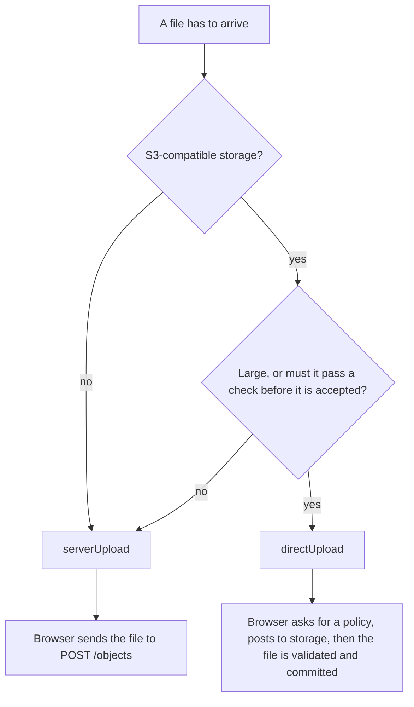

# Static Asset Component

`StaticAssetComponent` turns one declaration into a REST controller for files on disk or S3-compatible storage. You write the entry; it writes the routes.

```ts
import { DiskHelper } from '@venizia/ignis-helpers';
import type { TStaticAssetComponentOptions } from '@venizia/ignis/static-asset';

export const options: TStaticAssetComponentOptions = {
  documents: {
    basePath: '/documents',
    helper: new DiskHelper({ basePath: './app_data/documents' }),
  },
};
```

That registers upload, stream, download, list and delete under `/documents`. Every route is **open** until you set [`auth`](./security#authentication-and-authorization), and the four bucket-management routes stay off until you ask for them.

> [!WARNING]
> No `auth` means no authentication. Set it on every entry before it faces users: see [Security](./security).

## Two ways a file arrives

| | `serverUpload` | `directUpload` |
|---|---|---|
| Path | browser, then your app, then storage | browser, then storage (your app signs a permission) |
| Route | `POST /objects` | `POST /upload-policy`, then `POST /upload-validate`, then `POST /upload-commit` |
| Your process sees the bytes | yes, in memory or spooled to disk | no |
| Storage | disk or S3 | S3 only (a signed POST policy) |
| Check the file before accepting it | in your own code after the upload | `validation`, run before commit, and again at commit |
| Good for | images, documents, anything small | video, large files, imports that must be checked first |

An entry can turn either one on, both, or neither. `serverUpload` is on unless you set it to `false`; `directUpload` is on only when you declare it.



Start from one of the [three complete setups](./getting-started), then read [Server upload](./server-upload) or [Direct upload](./direct-upload).

## How it works

- **One entry, one controller.** `TStaticAssetComponentOptions` is a record. Each key is an entry with its own `basePath`, helper and auth. `StaticAssetControllerFactory.build` makes the controller while `StaticAssetComponent` binds.
- **The storage type is the helper.** Pass a `DiskHelper` or a `BunS3Helper`; there is no separate `storage` field.
- **Routes are named and switchable.** `routes.<key>` turns a built-in route off (`false`), on (`true`) or on with overrides (an object). See the [route table](./api#routes).
- **A bucket in the URL, or one bucket for the entry.** Without `bucket`, the caller names the bucket in the path. With it, the bucket leaves the URL and the entry works on one bucket only.
- **MetaLink is a table you own.** Give the entry a `metaLink` and every upload writes a row; leave it out and nothing is recorded.

## Pages

| Page | Read it to |
|---|---|
| [Getting started](./getting-started) | copy a complete declaration |
| [Server upload](./server-upload) | upload through your app, with labels and a MetaLink row |
| [Direct upload](./direct-upload) | upload straight to storage, validate, then commit |
| [Security](./security) | close what is open, and run the flow safely |
| [Usage](./usage) | read, list, delete and track objects |
| [Configuration reference](./api) | every option, route, key and helper |
| [Error reference](./errors) | every code and what to do about it |
| [Migration](./migration) | move from the old `controller`/`extra` shape |

## See also

- [Why a policy and not a presigned PUT](./direct-upload#why-a-policy-and-not-a-presigned-put) - the design behind direct upload.
- [Storage helpers](/extensions/helpers/storage/) - `DiskHelper`, `BunS3Helper` and the `IStorageHelper` contract.

**Files:**

- [`packages/core-server/src/components/static-asset/component.ts`](https://github.com/VENIZIA-AI/ignis/blob/main/packages/core-server/src/components/static-asset/component.ts)
- [`packages/core-server/src/components/static-asset/common/types.ts`](https://github.com/VENIZIA-AI/ignis/blob/main/packages/core-server/src/components/static-asset/common/types.ts)
- [`packages/core-server/src/components/static-asset/controller/factory.ts`](https://github.com/VENIZIA-AI/ignis/blob/main/packages/core-server/src/components/static-asset/controller/factory.ts)
