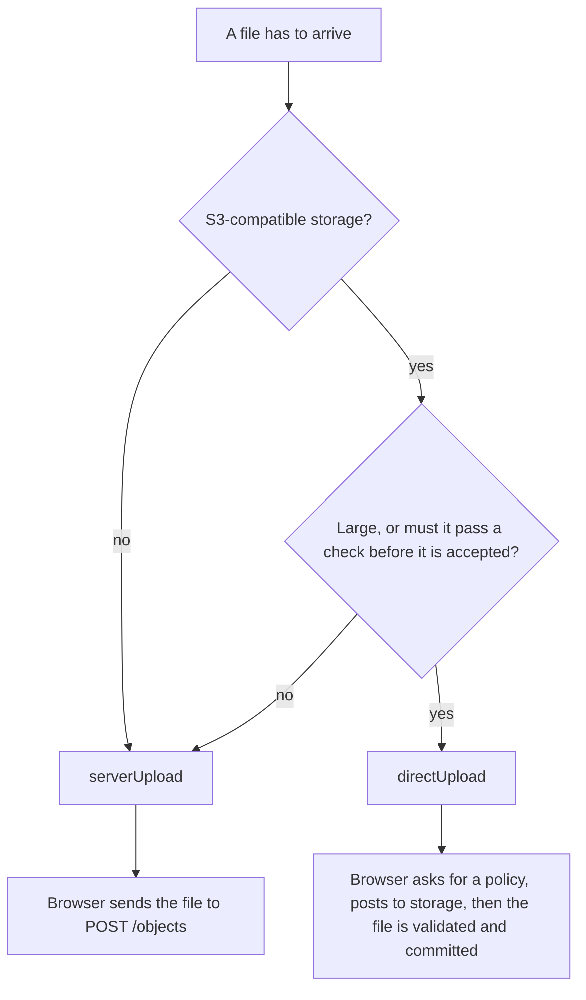

# Static Asset Component

`StaticAssetComponent` turns one declaration into a REST controller for the files in one bucket, on disk or S3-compatible storage. You write the entry; it writes the routes.

```ts
import { DiskHelper } from '@venizia/ignis-helpers';
import type { TStaticAssetComponentOptions } from '@venizia/ignis/static-asset';

export const options: TStaticAssetComponentOptions = {
  documents: {
    basePath: '/documents',
    bucket: 'documents',
    helper: new DiskHelper({ basePath: './app_data' }),
    serverUpload: { use: true },
    directUpload: { use: false },
    metaLink: { use: false },
  },
};
```

That registers upload, stream, download, list and delete under `/documents`. Every feature is a switch: `{ use: false }` or `{ use: true, ...options }`. Leave one out and the entry does not compile, so nothing is on or off by accident.

> [!WARNING]
> Every route is **open** until you set [`auth`](./security#authentication-and-authorization) on the entry. Set it before the entry faces users.

> [!IMPORTANT]
> The component never creates the bucket. Create it once before you start. See [Create the bucket](./getting-started#create-the-bucket).

## Two ways a file arrives

| Aspect | `serverUpload` | `directUpload` |
|---|---|---|
| Path | browser, then your app, then storage | browser, then storage (your app signs a permission) |
| Route | `POST /objects` | `POST /upload-policy`, `POST /upload-validate` (with a `validation`), `POST /upload-commit` |
| Your process sees the bytes | yes, the whole body in memory | no |
| Storage | disk or S3 | S3 only (a signed POST policy) |
| Needs a `keyPrefix` | no | yes |
| Check the file before accepting it | in your own code after the upload | `validation`, run once at `upload-validate`; commit takes the token it returns |
| Good for | images, documents, anything small | video, large files, imports that must be checked first |

An entry can turn either one on, both, or neither.



Start from one of the [three complete setups](./getting-started), then read [Server upload](./server-upload) or [Direct upload](./direct-upload).

## How it works

- **One entry, one controller.** `TStaticAssetComponentOptions` is a record. Each key is an entry with its own `basePath`, bucket, helper and auth. The controller's name comes from the key (`staticAsset` becomes `StaticAssetController`) unless you set `name`.
- **One bucket per entry.** `bucket` is required and never appears in a URL. To serve several buckets, declare several entries. There are no routes to list, create or delete buckets.
- **The helper is the storage.** Pass a `DiskHelper` or a `BunS3Helper`. The helper declares its own `storageType`, so there is no `storage` field.
- **Routes are named and switchable.** `routes.<key>` turns a built-in route off (`{ use: false }`) or on with overrides (`{ use: true, ... }`). See the [route table](./api#routes).
- **MetaLink is a table you own.** Switch `metaLink` on and every upload writes a row; switch it off and nothing is recorded.

## Pages

| Page | Read it to |
|---|---|
| [Getting started](./getting-started) | copy a complete declaration |
| [Server upload](./server-upload) | upload through your app, with labels and a MetaLink row |
| [Direct upload](./direct-upload) | upload straight to storage, validate, then commit |
| [Security](./security) | close what is open, and run the flow safely |
| [Usage](./usage) | read, list, delete and track objects |
| [Configuration reference](./api) | every option, route, key and helper |
| [Error reference](./errors) | every code and what to do about it |
| [Migration](./migration) | move from the old `controller` and `extra` shape |

## See also

- [Why a policy and not a presigned PUT](./direct-upload#why-a-policy-and-not-a-presigned-put) - the design behind direct upload.
- [Storage helpers](/extensions/helpers/storage/) - `DiskHelper`, `BunS3Helper` and the `IStorageHelper` contract.

**Files:**

- [`packages/core-server/src/components/static-asset/component.ts`](https://github.com/VENIZIA-AI/ignis/blob/main/packages/core-server/src/components/static-asset/component.ts)
- [`packages/core-server/src/components/static-asset/common/types.ts`](https://github.com/VENIZIA-AI/ignis/blob/main/packages/core-server/src/components/static-asset/common/types.ts)
- [`packages/core-server/src/components/static-asset/controller/factory.ts`](https://github.com/VENIZIA-AI/ignis/blob/main/packages/core-server/src/components/static-asset/controller/factory.ts)
